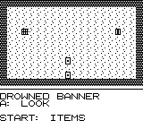

# SEVENFOLD

A mini Shadowgate-like first-person castle crawler for the Game Boy.
Explore a haunted castle in two colors, solve item puzzles, and at
certain spots sacrifice a virtue to advance — gaining its paired sin.
Full corruption is not game over: it is a dark ending, where you
become the keeper.

Sins are visual and story only — they never change the mechanics.


## Play

Download the ROM and run it in any Game Boy emulator: **[sevenfold.gb](https://raw.githubusercontent.com/retroromrunner/sevenfold/main/releases/sevenfold.gb)**

Controls: D-pad cycles hotspots, A interacts, B cancels, Start opens
the inventory and virtue list.

## The castle — 44 rooms

The 1.1 release expands the castle to **44 rooms** in total: the
original 31-room castle, plus the 13-room Drowned Wing.

**The original castle (31 rooms):** Gatehouse, Courtyard, Great Hall,
Kitchen, Library, Chapel, Crypt, Gallery, Stair, Vestibule, Observatory,
Chasm, Archive, Echo Hall, Reliquary, Smithy, Belfry, Pantry, Armory,
Patio, Garden, Shed, Chart Room, Choir Loft, a five-room passage chain,
Deep Cell, Larder, and Cellar. Every room carries a short, gloomy
description, and items are spread several rooms from the obstacles
they solve, so progress runs on deliberate backtracking: the rope from
the shed for the courtyard well, the ladder from the gallery for the
chapel descent, the axe from the armory for the courtyard dead tree,
the star chart from the chart room for the library prism, and more.

**The Drowned Wing (13 rooms, off the Reliquary):** Wing Antechamber,
Flooded Gallery, Sunken Chapel, Well Chamber, Ice Chamber, Torch Vault,
Gem Gallery, Gem Slot Hall, Riddle Hall, Knight's Guard, Hope Chapel,
Keeper's Antechamber, and Seal Chamber. Shadowgate-style puzzles run
through it: an ember torch melts a frozen pool for an ice key, a pale
gem set in a slot opens a hidden door, a moonstone answers a riddle
guardian, and a silver blade gets past a drowned knight. The wing's
two key items are locked on purpose — the Moonstone needs a Star Key
from the Sunken Chapel, the Blade needs a Drowned Key from the Slot
Hall — so you enter the wing, collect the keys, backtrack to the old
castle for both items, and return to finish the wing. The final exit
needs the joined Final Key **and** the Keeper's Seal from the Seal
Chamber.

## Virtues, sins, and endings

There are eight virtue-to-sin pairs: Humility to Pride, Patience to
Wrath, Charity to Greed, Temperance to Gluttony, Chastity to Lust,
Diligence to Sloth, Kindness to Envy, and Hope to Despair.

Three gates demand a sacrifice: the Great Hall gate, the Chapel gate,
and the Hope gate in the Drowned Wing. Five more sacrifices are
optional pacts, offered by the portrait, altar, skull, shrine, and
throne. Endings follow how many virtues you give up:

- **Pure:** 3 sins, the three required gates only, no optional pacts.
- **Tainted:** 4 to 7 sins.
- **Keeper:** all 8 sins, the dark ending.

## Screenshots





## 1.1 release

The approved 1.1 ROM is `releases/sevenfold.gb`, a plain 32KB ROM,
md5 `6524a5b74aee16717696d742d2b7405f`. The 1.0 build remains tagged
as `v1.0` as a fallback.

## Build from source

Requires the GBDK-2020 toolchain. From the project root:

```
./build.sh
```

This regenerates the tile and room headers from `gen_tiles.py` and
compiles `src/main.c` into `releases/sevenfold.gb` (a plain 32KB ROM).
