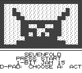
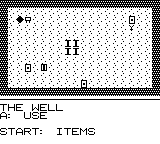
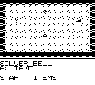
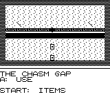
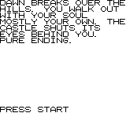

# SEVENFOLD

A mini Shadowgate-like first-person castle crawler for the Game Boy.
Explore a haunted castle in two colors, solve item puzzles, and at
certain spots sacrifice a virtue to advance — gaining its paired sin.
Full corruption is not game over: it is a dark ending, where you
become the keeper.

There are three endings depending on how many virtues you sacrifice:
stay pure, end tainted, or give in completely and become the keeper.

Sins are visual and story only — they never change the mechanics.


## Play

Download the ROM and run it in any Game Boy emulator: **[sevenfold.gb](https://raw.githubusercontent.com/retroromrunner/sevenfold/main/releases/sevenfold.gb)**

Controls: D-pad cycles hotspots, A interacts, B cancels, Start opens
the inventory and virtue list.

## Screenshots







## Build from source

Requires the GBDK-2020 toolchain. From the project root:

```
./build.sh
```

This regenerates the tile and room headers from `gen_tiles.py` and
compiles `src/main.c` into `releases/sevenfold.gb` (a plain 32KB ROM).
